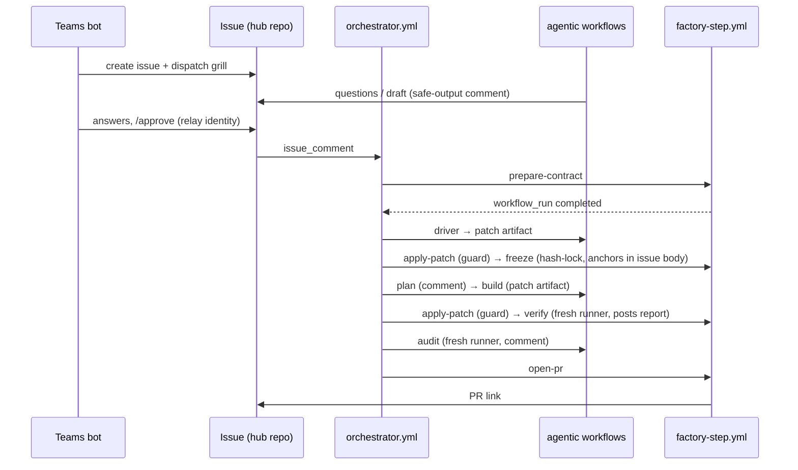

# Architecture

## Shared core (`shared/factory_core`)

| Module | Responsibility |
|---|---|
| `models.py` | IntentSpec, SpecDraft, GrillTurn, TaskGraph (DAG + layering), GateResult, VerificationReport (+ stall fingerprint), AuditResult, FactoryConfig |
| `tad_runner/` | tests-as-data loader (CSV/YAML), Gherkin generation + execution, Hypothesis properties, drivers (jsonl/http/cli), comparisons + approval-style diffs, freeze check, JUnit/JSON reports — CLI `tad` |
| `guard/` | manifest lock/verify (external trust anchor), change rules on git diffs or agent patches — CLI `factory-guard` |
| `gates/` | deterministic verification gates driven by stack profiles — CLI `factory-gates` |
| `mutation/` | `pymut` (factory-owned AST mutation testing for Python, killing with unit + contract tests) and a threshold checker for Stryker/PIT reports |
| `stack_profiles/` | python, node, java, dotnet, go: detection, globs, guarded settings, skip markers, gate commands, driver templates |
| `agents/` | headless adapters for **GitHub Copilot CLI**, **Claude Code**, **Codex** + scripted fake; fresh session per call, protected paths read-only, JSON-schema answers with one repair retry |
| `prompts/` | grill, driver writer, planner, builder, test auditor, conflict resolver |
| `pipeline.py` | phase logic used by both factories (grill prompt, critic, write/freeze contract, builder/auditor prompts, fresh clone) |
| `reports/` | gate tables, failure briefs for fresh builders, PR bodies, chat summaries |

## LangGraph factory

```mermaid
flowchart LR
  intake --> recon --> grill_turn
  grill_turn -- critic found gaps --> grill_turn
  grill_turn --> ask_human{{interrupt: questions / approval}}
  ask_human -- answer --> grill_turn
  ask_human -- /approve --> freeze
  ask_human -- /abort --> END
  freeze -- freeze check failed --> ask_human
  freeze --> plan --> schedule
  schedule -- Send per ready task --> worker1[worker (worktree)]
  schedule -- Send --> worker2[worker (worktree)]
  worker1 --> integrate
  worker2 --> integrate
  integrate --> schedule
  schedule -- DAG done --> verify
  subgraph verify [verify — own state, fresh clone]
    checkout --> gates --> audit
  end
  verify --> triage
  triage -- green --> pr --> END
  triage -- red --> schedule
  triage -- stalled / contradiction --> escalate{{interrupt}}
  escalate -- continue --> schedule
  escalate -- amend --> grill_turn
  escalate -- abort --> END
```

- **Checkpointing**: Postgres (`DATABASE_URL`) or in-memory; `thread_id` = feature key, so a feature survives
  restarts and can wait days for a human.
- **Graph engineering**: the planner's DAG is executed layer by layer; each ready task is a `Send` to a worker
  that runs a fresh builder session in its own git worktree; `integrate` merges branches (conflicts → resolver
  agent). Fix rounds are single-task graphs built from the failure brief.
- **Clean context**: the `verify` node hands the subgraph only `{commit, freeze_sha, manifest_hash, spec,
  stack, engine}`; the subgraph clones the repo afresh, runs the gates, and the auditor agent runs read-only in
  that clone.
- **Sandbox**: `FACTORY_SANDBOX=docker` runs every agent call in a throw-away container with the contract
  bind-mounted read-only.

## gh-aw factory



- Agentic workflows never hold write tokens: they export a patch; only `factory-step` (deterministic) applies it
  after the guard approves it.
- Trust anchors (approved root hash, freeze SHA) live in a hidden block of the **issue body**, which no agent
  safe-output can edit.
- `engine:` is compile-time in gh-aw, so `gen_workflows.py` emits each phase for copilot / claude / codex and the
  orchestrator dispatches the variant chosen during the grill.
- `templates/target-repo/factory-guard.yml` re-verifies the contract on every factory PR as a required check.
