# AI Software Factory — How it works today

> **Audience:** engineers, tech leads and reviewers who want to understand, operate or extend the factory.
> **Scope:** describes the behaviour of the code currently in `tech-nl-devai-software-factory` (both the
> LangGraph and the gh-aw implementations plus the shared core).
>
> **Confluence tip:** every diagram is a Mermaid block. Paste each block into a *Mermaid* macro
> (e.g. "Mermaid Diagrams for Confluence") or import this page with a Markdown importer that supports Mermaid.

---

## 1. TL;DR

A requester asks for a feature (in Teams, a terminal or via HTTP). The factory:

1. **Grills** the requester until the intent is unambiguous.
2. Turns the answers into an **executable contract** — *tests as data* (CSV tables, YAML scenarios, properties,
   generated Gherkin) plus a thin, assertion-free **driver**.
3. **Freezes** the contract: proves the tests are not vacuous, hash-locks them and stores the root hash
   **outside the reach of any agent**.
4. **Plans** the work as a task DAG and lets coding agents (**GitHub Copilot CLI, Claude Code or Codex**)
   **build** it in fresh sessions, with the contract read-only.
5. **Verifies** the result in a **clean context** (fresh clone, fresh agent) through 15 deterministic gates
   plus an independent **test auditor**.
6. **Loops** build ⇄ verify until green; a **stall breaker** hands control back to the human.
7. Opens a **pull request** that documents contract, gate results, iterations and manifest hash.

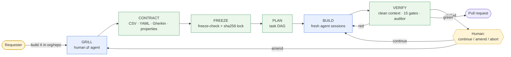

Legend used throughout: **blue** = coding agent (LLM), **yellow** = human decision, **green** = deterministic code.

---

## 2. Repository layout and building blocks

Two interchangeable **factory runtimes** share one **core** and one set of **chat channels**.

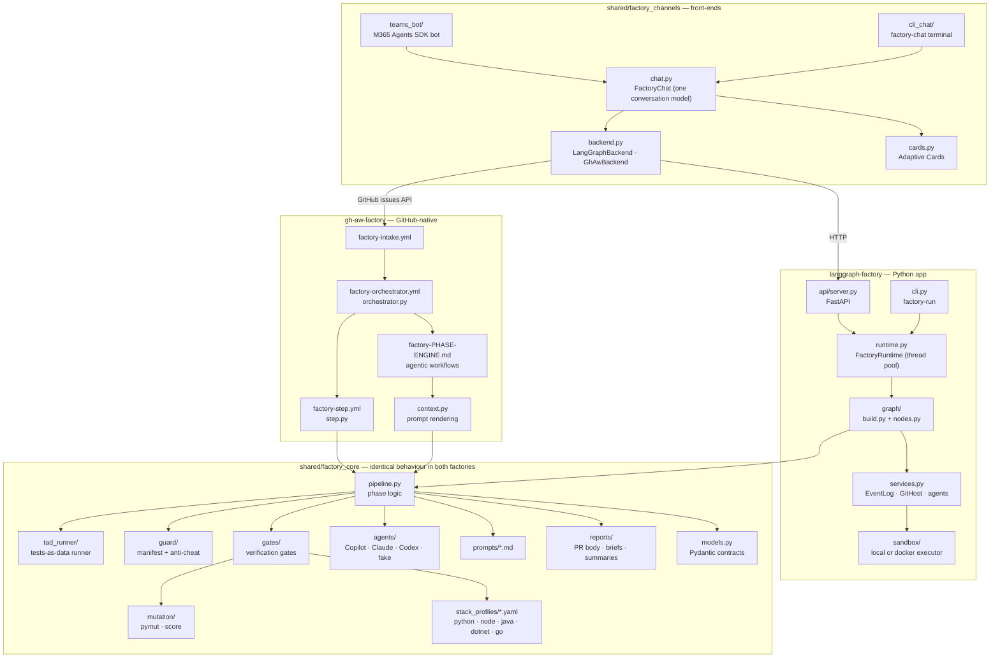

| Folder | What lives there |
|---|---|
| `shared/factory_core/` | Everything that must behave identically: tests-as-data runner (`tad`), guard (`factory-guard`), gates (`factory-gates`), mutation testing (`pymut`), agent adapters, prompts, stack profiles, reports, Pydantic models and JSON schemas. |
| `shared/factory_channels/` | One chat core + two backends (LangGraph HTTP, gh-aw issues) + Teams bot + terminal client. |
| `langgraph-factory/` | LangGraph graph, FastAPI server, runtime, sandbox executors, Dockerfiles, `docker-compose.yml`. |
| `gh-aw-factory/` | Workflow generator, deterministic orchestrator, deterministic steps, generated agentic workflows, target-repo guard template. |
| `examples/` | Sample target repos (`python-greeter`, `node-todo`) and canned contracts used by demos and e2e tests. |

### Comparison of the two runtimes

| | **LangGraph factory** | **gh-aw factory** |
|---|---|---|
| Runtime | Python app (FastAPI + LangGraph) | GitHub Agentic Workflows + GitHub Actions |
| Feature state | LangGraph checkpointer (Postgres or in-memory); `thread_id` = feature key | One GitHub Issue in a hub repo (labels, comments, hidden state block in body) |
| Human-in-the-loop | `interrupt()` / `Command(resume=…)` via HTTP | Issue comments (`/approve`, `/continue`, …) |
| Build | DAG fanned out with `Send` → parallel workers in git worktrees → `integrate` merges | DAG flattened in topological order, executed by one agent run |
| Clean verify | Separate subgraph with its own state type + fresh `git clone --no-local` | Separate workflow run on a fresh runner |
| Trust anchor storage | Checkpoint DB (`manifest_hash`, `freeze_sha`) | Hidden `factory:state` block in the issue body |
| Write access | Factory process | Only `factory-step.yml` (GitHub App token); agents get read-only tokens |
| Deploy | `docker compose up` | Hub repo + GitHub App |

---

## 3. End-to-end lifecycle of a feature

### 3.1 Feature status (LangGraph `FactoryState.status`)

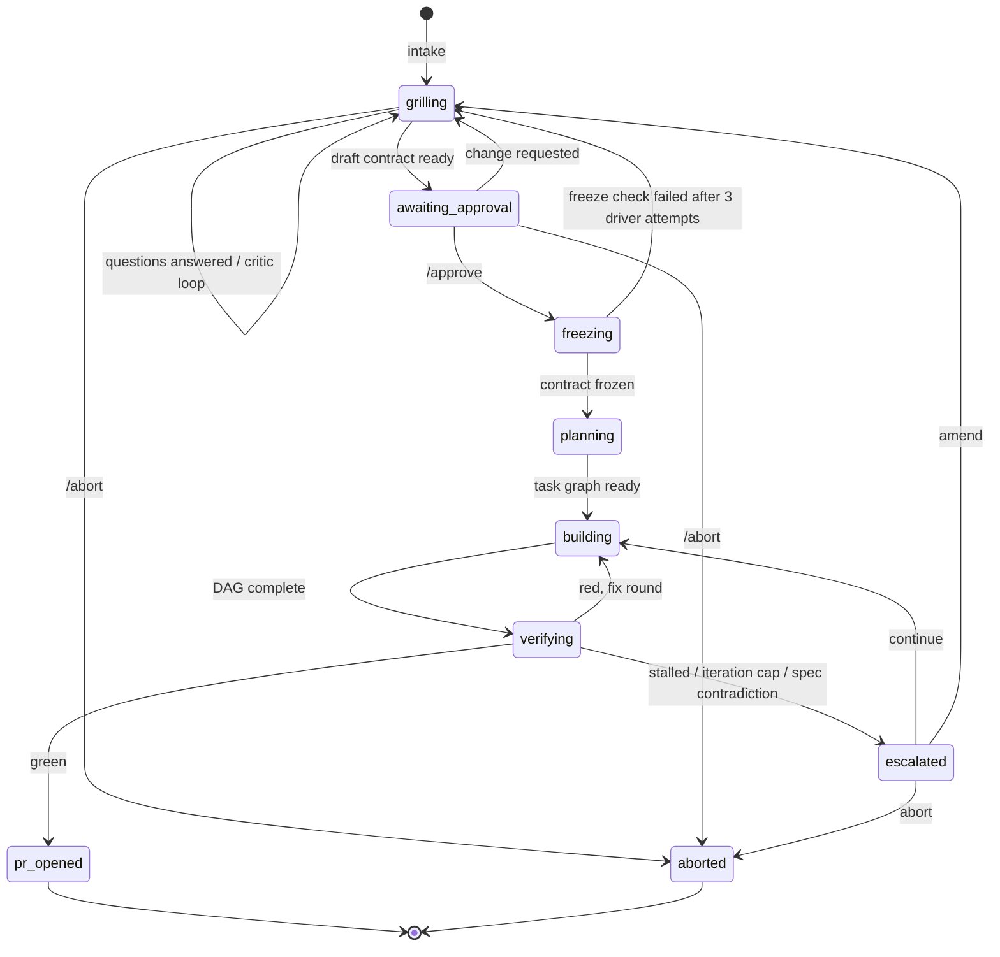

### 3.2 Who does what

| Phase | Actor | Agent role / tool | Writes? | Output |
|---|---|---|---|---|
| Intake | deterministic | — | — | feature key, engine, transcript seed |
| Recon | deterministic | `detect_stack`, `repo_map` | clone + `factory/<key>` branch | stack, repo map |
| Grill | **agent** | `grill` (read-only) + deterministic **spec critic** | no | `GrillTurn` (questions or `SpecDraft`) |
| Approval | **human** | — | — | `/approve`, changes, `/engine`, `/abort` |
| Freeze | **agent** + deterministic | `driver_writer` (contract files protected) → `freeze_check` → `lock` | driver only | `manifest.lock.json`, freeze commit, root hash |
| Plan | **agent** | `planner` (read-only) | no | `TaskGraph` (DAG); fallback = 1 task covering all ACs |
| Build | **agent(s)** | `builder` (protected paths read-only) | yes | commits on task branches |
| Integrate | deterministic (+ agent on conflicts) | `resolver` | yes | merged feature branch |
| Verify | deterministic | 15 gates | no | `VerificationReport` |
| Audit | **agent** | `auditor` (read-only, never saw the build) | no | `AuditResult` findings |
| Triage | deterministic | fingerprint / stall logic | — | fix task / escalation / PR |
| PR | deterministic | `GitHost` / `gh pr create` | push | PR URL (or local `PR.md`) |

---

## 4. The contract: tests as data

The human ↔ AI contract is a set of **data files** executed by a **factory-owned runner**. Agents never
write test code with assertions — all assertions live in the runner; the per-feature **driver** only maps
DSL operations onto the system's public interface.

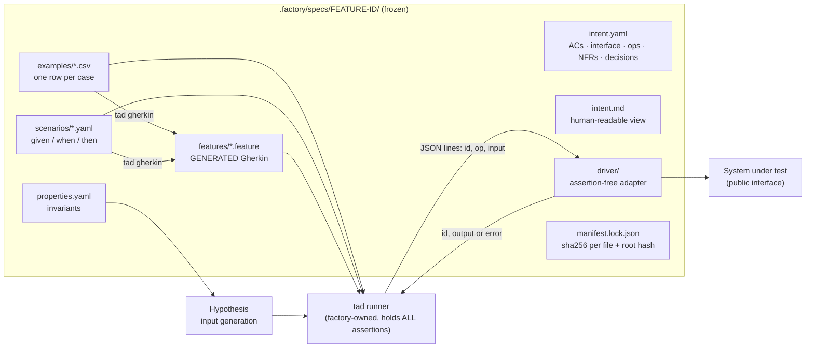

Driver protocol (JSON lines over stdin/stdout, plus `__ping__` and `__reset__`):

```
→ {"id": 1, "op": "greet", "input": {"name": "Joe"}}
← {"id": 1, "output": {"greeting": "Hello, Joe!"}}      or   {"id": 1, "error": "Name must not be …"}
```

Interface kinds: `jsonl` (driver process, templates for Python and Node), `http` (routes on a base URL) and
`cli` (argv templates).

### 4.1 Contract data model

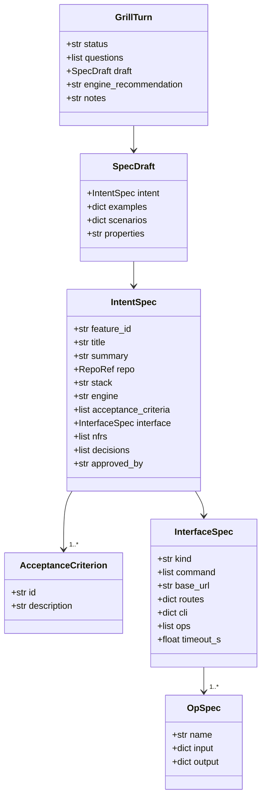

- `GrillTurn.status` is `questions` or `draft`; `engine` is `copilot`, `claude` or `codex`.
- `AcceptanceCriterion.id` matches `AC-<n>`; `InterfaceSpec.kind` is `jsonl`, `http` or `cli`.

### 4.2 Validation rules (spec critic + freeze check)

`tad_runner.runner.validate()` is used by the **spec critic** during grilling (max 2 automatic revision rounds)
and again before freezing:

- `intent.yaml` must validate against `IntentSpec`.
- Every case's `ac_id` must exist; every op must be declared in `interface.ops`.
- **Every acceptance criterion needs at least one example, scenario or property.**
- Generated `.feature` files must be in sync with their data files.
- A `jsonl` interface must declare its driver `command`.

`freeze_check()` additionally proves the tests are meaningful **on today's code**:

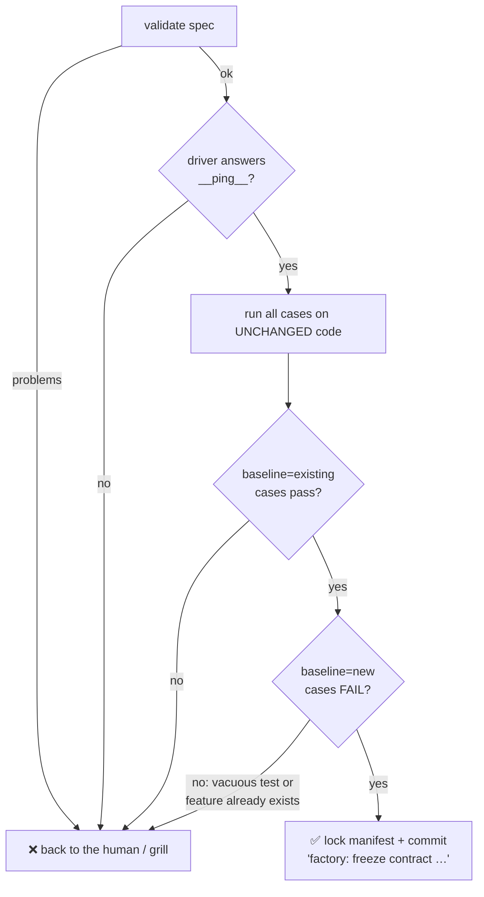

---

## 5. LangGraph factory

### 5.1 Deployment (local-first)

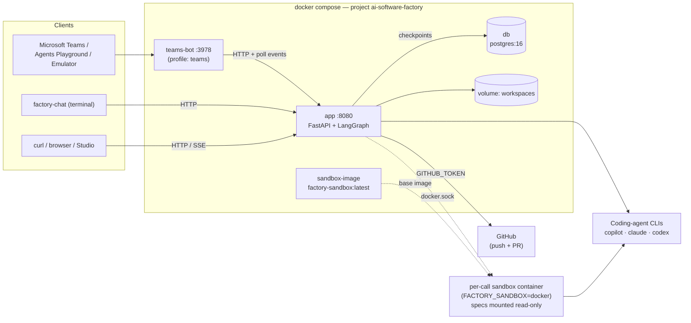

**Key configuration** (environment):

| Variable | Purpose | Default |
|---|---|---|
| `DATABASE_URL` | Postgres checkpointer; absent → in-memory | unset |
| `FACTORY_WORKSPACES` | Where feature clones live | `./workspaces` |
| `FACTORY_SANDBOX` | `local` or `docker` (one container per agent call) | `local` |
| `FACTORY_SANDBOX_IMAGE` | Image for docker sandbox | `factory-sandbox:latest` |
| `FACTORY_FAKE_AGENT` | `greeter` = scripted demo agent, no LLM | unset |
| `FACTORY_CONFIG` | YAML with thresholds (see §8) | built-in defaults |
| `FACTORY_NOTIFY_URL` | Webhook for every event | unset |
| `GITHUB_TOKEN` / `GITHUB_API_URL` | Push branch + open PR | unset → writes `PR.md` |
| `FACTORY_<ENGINE>_BIN` / `_ARGS` | Override CLI binary / extra flags per engine | — |
| `COPILOT_GITHUB_TOKEN`, `ANTHROPIC_API_KEY`, `OPENAI_API_KEY` | Engine credentials (passed through to sandboxes) | — |

### 5.2 HTTP API

| Method | Path | Body / params | Notes |
|---|---|---|---|
| `GET` | `/health` | — | fake agent + sandbox mode |
| `POST` | `/features` | `{request, repo, base_branch?, engine?, requester?, notify_url?}` | 202 → `{feature_key}` |
| `POST` | `/features/{key}/messages` | `{text?, action?, engine?, user?}` | 409 while the graph is busy or not waiting for input |
| `GET` | `/features/{key}` | — | status, `waiting_for` (current interrupt), iteration, PR URL, last report |
| `GET` | `/features/{key}/events` | `after=N&wait=S` | long-poll event log |
| `GET` | `/features/{key}/stream` | — | Server-Sent Events |

### 5.3 Runtime model

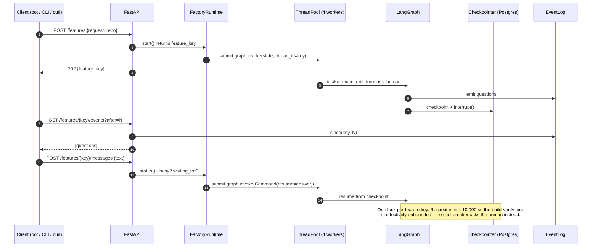

### 5.4 The graph

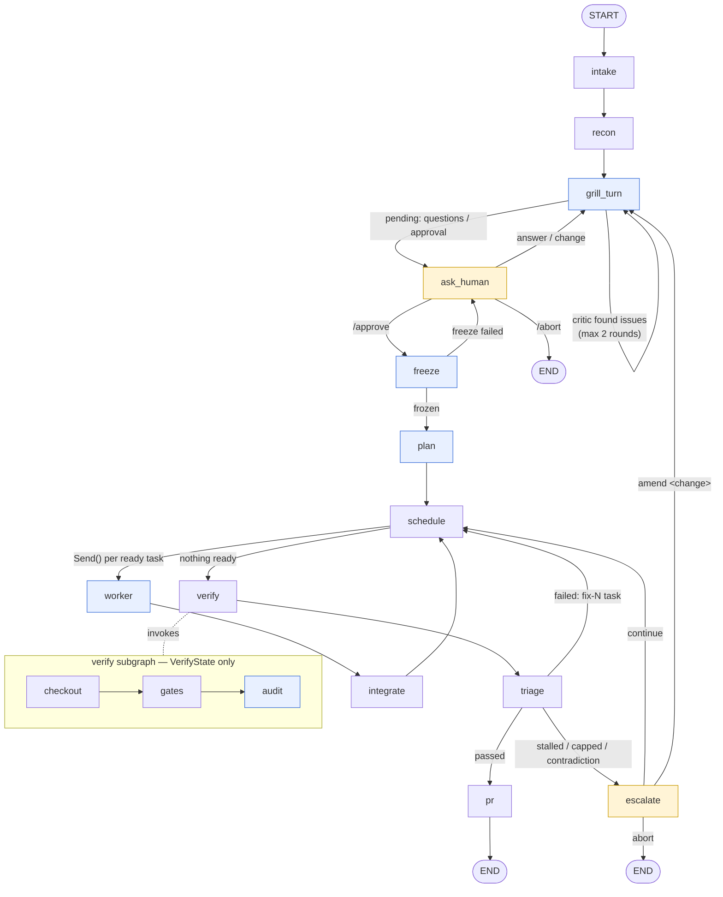

`integrate` calls the `resolver` agent only on merge conflicts. Everything not coloured is deterministic Python.

| Node | LLM? | What it does |
|---|---|---|
| `intake` | no | Picks engine (request or `default_engine`), resets counters, seeds the transcript. |
| `recon` | no | Clones into `workspaces/<key>/repo` (plain folders are imported as a fresh repo), creates `factory/<key>`, detects the stack, builds a repo map. |
| `grill_turn` | yes, read-only | Questions or a draft; drafts pass through the spec critic (≤2 self-loops), then are rendered for approval (`intent.md` preview written). |
| `ask_human` | no | `interrupt()`; handles `/approve`, `/abort`, `/engine X`, free-text answers. |
| `freeze` | yes, write | Writes contract, driver-writer agent (≤3 attempts with feedback), `pipeline.freeze`. |
| `plan` | yes, read-only | `TaskGraph`; fallback single task. |
| `schedule` | no | Resets `task_results`; router fans out `Send("worker", …)` or goes to `verify`. |
| `worker` | yes, write | Own worktree + branch `factory-task/<key>/<task>-<iter>-<rand>`, builder agent, commit. |
| `integrate` | on conflict | `merge --no-ff` each branch; resolver on conflicts; cleans worktrees. |
| `verify` | — | Invokes the verify subgraph with commit + anchors only. |
| `triage` | no | Pass → `pr`; fail → `fix-N`; stall / cap / contradiction → `escalate`. |
| `escalate` | no | `interrupt()`; continue / amend / abort. |
| `pr` | no | PR body + `GitHost.open_pr` (GitHub API, or local push + `PR.md`). |

### 5.5 Graph engineering: parallel build with worktrees

The planner returns a DAG. `TaskGraph.topological_layers()` (Kahn layering) defines what can run in parallel;
`route_schedule` sends one `worker` per **ready** task.

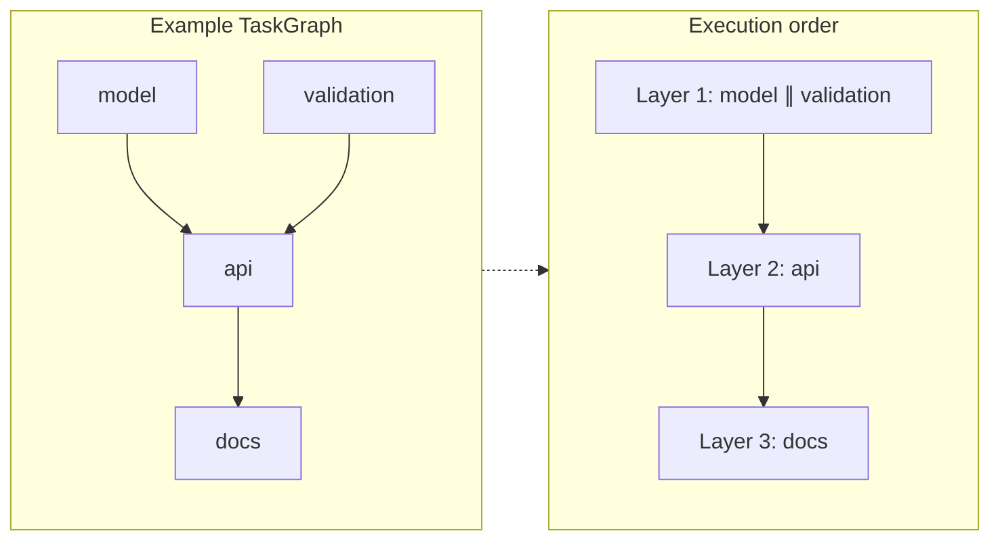

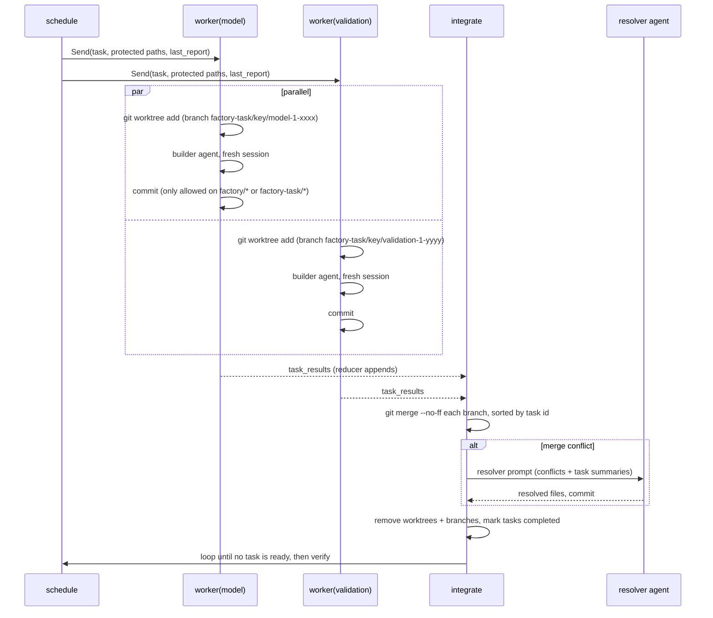

Git branch model of a feature:

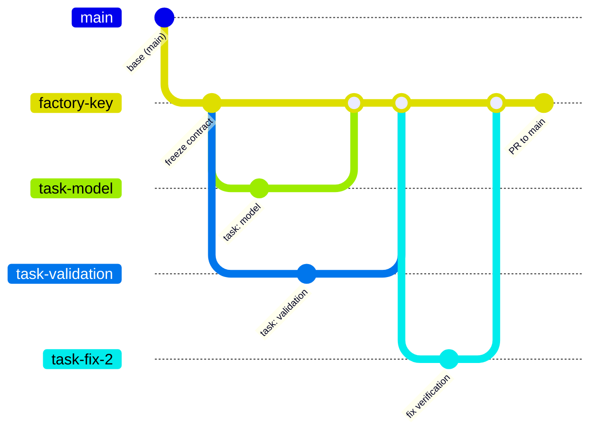

(Real names: `factory/<feature-key>` and `factory-task/<feature-key>/<task>-<iteration>-<rand>`. The freeze
commit carries the `Approved-by` and `Contract-Root-Hash` trailers.)

### 5.6 Clean-context verification

`verify` hands the subgraph **only** `{feature_id, source_repo, commit, freeze_sha, manifest_hash, spec_rel,
stack, engine, iteration, verify_dir}` — no transcript, no build logs, no working directory.

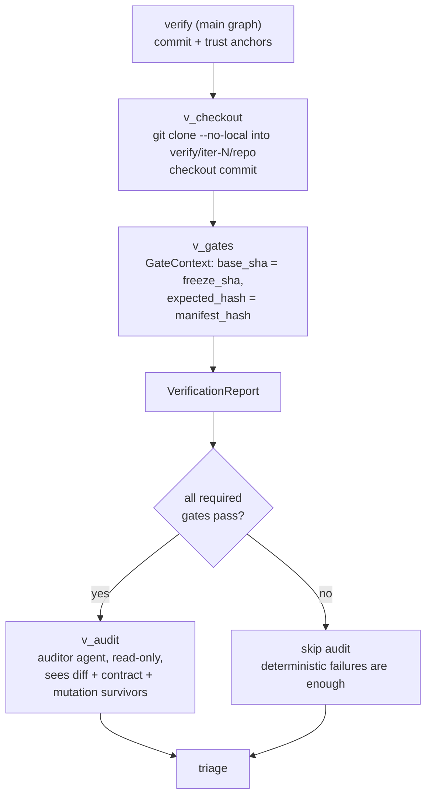

### 5.7 Triage and the stall breaker

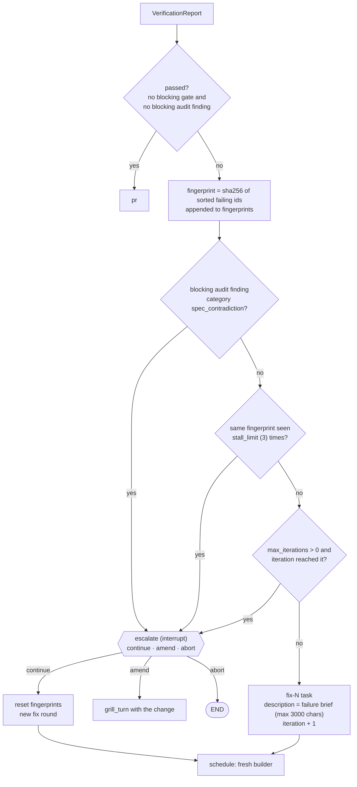

Failure ids feeding the fingerprint are stable: JUnit test ids for `unit`, `file:line:operator` for surviving
mutants, case ids for contract gates, `rule:path` for guard violations.

---

## 6. gh-aw factory (GitHub Agentic Workflows)

### 6.1 Architecture and permissions

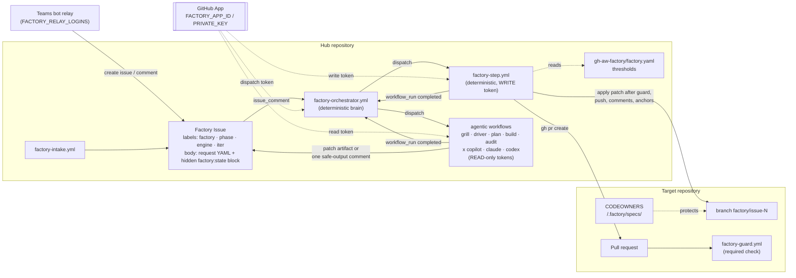

**Security properties**

- Agentic workflows **never** hold a write token for the target: they export `agent.patch` as an artifact.
  Only `factory-step` applies it — after the guard approves it.
- Trust anchors (`manifest_hash`, `freeze_sha`, `spec_rel`, `stack`, `approver`) live in a hidden
  `<!-- factory:state {...} -->` block in the **issue body**; no agent safe-output can edit the body.
- Only `OWNER` / `MEMBER` / `COLLABORATOR` comments (or the configured relay account) steer the factory;
  bot comments never do.
- `engine:` is compile-time in gh-aw, so `gen_workflows.py` generates every phase per engine; the orchestrator
  dispatches the variant chosen during the grill.
- The orchestrator dispatches with the App token so that chained `workflow_run` events fire.
- Each agentic run renders its own prompt with `context.py` on a fresh runner → fresh context per phase.

### 6.2 Orchestrator state machine (issue `phase:` label)

`orchestrator.decide(event, issue)` is a pure, unit-tested function triggered by human comments and by every
factory workflow completion.

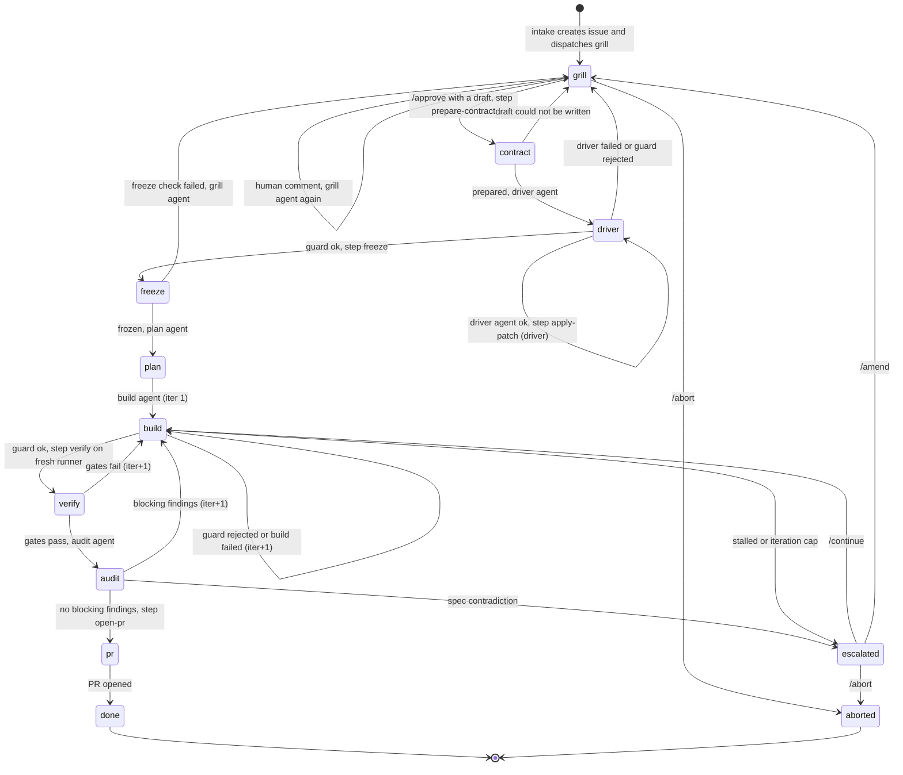

### 6.3 Happy path sequence

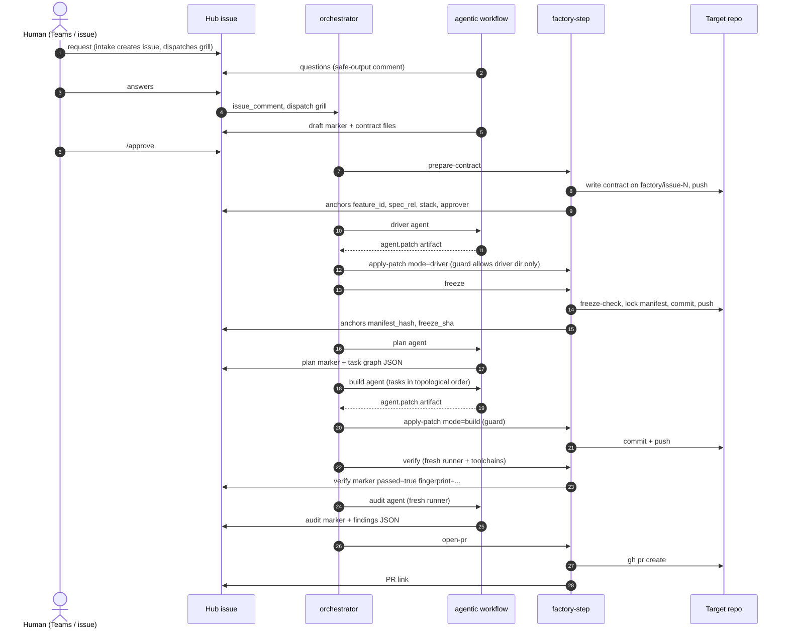

### 6.4 The issue as a state store

| Element | Content | Who writes it |
|---|---|---|
| Labels | `factory`, `phase:<…>`, `engine:<copilot\|claude\|codex>`, `iter:<n>` | intake / orchestrator |
| Body — request | ```` ```yaml factory-request ```` with `repo`, `base`, `request`, `requester` | intake / Teams bot |
| Body — state | `<!-- factory:state {"feature_id", "spec_rel", "stack", "approver", "manifest_hash", "freeze_sha"} -->` | `factory-step` only |
| Comments | markers `factory:draft`, `factory:plan`, `factory:verify iteration= passed= fingerprint=`, `factory:audit`, `factory:freezefailed` | agents (safe-output) / steps |

Hub setup: GitHub App (`Contents`, `Pull requests`, `Issues`, `Actions` read & write) installed on hub + targets;
`FACTORY_APP_ID`, `FACTORY_APP_PRIVATE_KEY`, engine secrets, optional `FACTORY_DEFAULT_ENGINE`,
`FACTORY_STALL_LIMIT`, `FACTORY_MAX_ITERATIONS`, `FACTORY_RELAY_LOGINS`, `FACTORY_BOT_LOGINS`. Each target repo
adds `factory-guard.yml` as a required check and a `CODEOWNERS` rule for `/.factory/specs/`.

---

## 7. Anti-cheat: defence in depth

The contract is the one thing the coding agent must not change. It is protected at every layer:

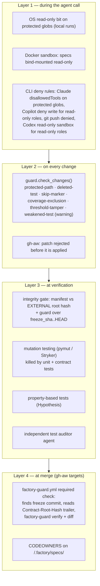

| Attempt | Caught by |
|---|---|
| Edit/delete a CSV, YAML, feature file or driver | read-only during build · guard `protected-path` · manifest vs external root hash |
| Re-lock the manifest after editing | external trust anchor (approved root hash is not in the repo) |
| Add `skip` / `xfail` / `it.skip` / `@Disabled` | guard `skip-marker` (per stack profile) |
| Delete or move existing tests | guard `deleted-test` |
| Lower coverage / mutation thresholds | thresholds live in the factory; guard `threshold-tamper`; guarded config files |
| `# pragma: no cover`, `istanbul ignore`, `Stryker disable` | guard `coverage-exclusion` |
| Weaken assertions in existing tests | guard warning → auditor |
| Tests that assert nothing / mock everything | mutation testing + auditor |
| Special-case the examples | property-based tests + mutation testing + auditor |
| Touch CI workflows / CODEOWNERS | always-protected paths |

**Always protected:** `.factory/specs/**`, `.github/workflows/**`, `CODEOWNERS`, `.github/CODEOWNERS`,
`.factory/config/**`, plus the stack profile's `guarded_files` (e.g. `pytest.ini`, `.coveragerc`,
`jest.config.*`, `stryker.conf.*`).

### 7.1 Hash-lock and trust anchor

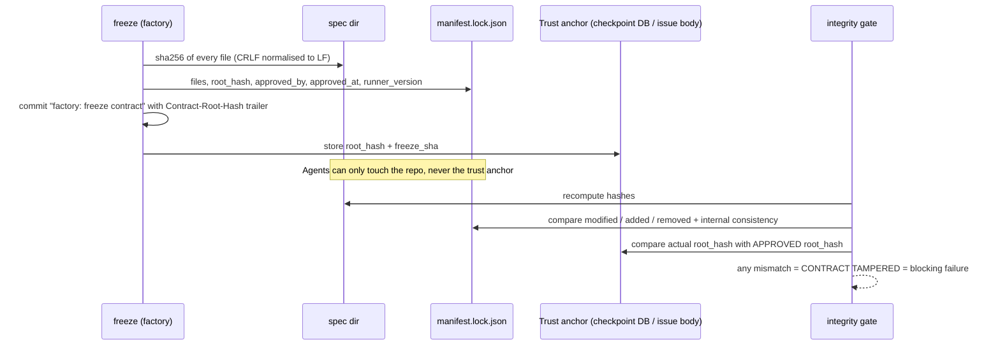

---

## 8. Verification gates

All gates run every iteration (so the builder gets the full picture at once). `base_sha` is the **freeze
commit**, so every diff measured is exactly the agent's production change.

```mermaid
flowchart LR
    integrity --> setup --> frontend_dependencies --> lint --> typecheck --> build --> unit
    unit --> playwright --> diff_coverage --> contract --> acceptance --> property --> mutation --> regression --> security

    classDef always fill:#eaf7ea,stroke:#2e8b57;
    classDef stack fill:#f3eefc,stroke:#7a4fd0;
    classDef fe fill:#fff4d6,stroke:#c99a00;
    classDef opt fill:#f2f2f2,stroke:#888;
    class integrity,contract,acceptance,property always;
    class setup,lint,typecheck,build,unit,diff_coverage,mutation,regression stack;
    class frontend_dependencies,playwright fe;
    class security opt;
```

Green = factory-owned, purple = command from the stack profile, yellow = front-end projects only,
grey = optional tools.

| Gate | Source | Blocking? | What it checks |
|---|---|---|---|
| `integrity` | factory | yes | manifest vs external hash + guard rules over `freeze_sha..HEAD` |
| `setup` | stack profile | per profile | install deps (only if `run_setup` and the profile defines setup) |
| `frontend_dependencies` | factory | yes (front-ends only) | packages referenced by `vite/next/astro/nuxt/postcss` configs are declared in `package.json` |
| `lint` | stack profile | no (python/node) | `ruff` / `eslint` on changed sources |
| `typecheck` | stack profile | no (python/node) | `mypy` / `tsc --noEmit` |
| `build` | stack profile | yes | `compileall` / `npm run build` / … |
| `unit` | stack profile | yes | full test suite with coverage (JUnit + Cobertura) |
| `playwright` | factory | yes (front-ends only) | requires `@playwright/test`, a config, a `test:e2e` script and a spec; installs Chromium, runs `npm run test:e2e` |
| `diff_coverage` | stack profile | yes | `diff-cover` vs freeze commit ≥ `diff_coverage_threshold` |
| `contract` | factory (`tad`) | yes | CSV tables + YAML scenarios |
| `acceptance` | factory (`tad`) | yes | generated / hand-written Gherkin |
| `property` | factory (`tad`) | yes | Hypothesis property tests |
| `mutation` | stack profile | yes | `pymut` (Python) / Stryker + `score` (Node) ≥ `mutation_threshold` |
| `regression` | stack profile | per profile | separate regression run where `unit` does not already cover it |
| `security` | factory | no | `semgrep` on changed files, `gitleaks` on `freeze_sha..HEAD` (skipped if not installed) |

A gate is **blocking** when it is `required` and its status is `fail` or `error`. A missing tool yields
`skip` for optional commands and `error` for required ones.

**Thresholds** live in the factory (`FACTORY_CONFIG` / hub `factory.yaml`), never in target repos:

| Key | Default | Meaning |
|---|---|---|
| `diff_coverage_threshold` | 80 | % coverage of changed lines |
| `mutation_threshold` | 70 | % mutants killed |
| `max_mutants` | 150 | cap per run |
| `stall_limit` | 3 | identical fingerprint N times → escalate |
| `max_iterations` | 0 | 0 = loop until green (stall breaker still applies) |
| `gate_timeout_s` | 900 | per command |
| `default_engine` | `copilot` | engine if the requester does not choose |
| `run_setup` | `true` | run the stack's setup commands |

### 8.1 Stack profiles

`shared/factory_core/stack_profiles/*.yaml` (python, node, java, dotnet, go) make the gates language-agnostic:
detection files and priority, `src_globs` / `test_globs`, `guarded_files`, `guarded_line_patterns`,
`skip_markers`, `coverage_exclusions`, `assertion_patterns`, a **driver template**, `setup` and gate `commands`
(argv lists — no shell — with placeholders such as `{changed_src...}`, `{base_sha}`, `{out}`,
`{mutation_threshold}`).

---

## 9. Coding-agent adapters

The factory never calls a model API directly; it drives the chosen **coding-agent CLI** headlessly.
**Every call is a fresh session** (no resume), so each phase starts with only the context the factory passes in.

```mermaid
flowchart TD
    N["Node or step builds AgentRequest<br/>role, prompt, workdir, protected,<br/>read_only, schema"] --> RUN[AgentRunner.run]
    RUN --> SUF{schema?}
    SUF -- yes --> ADD["append JSON-Schema suffix<br/>generated from the Pydantic model"]
    SUF -- no --> RO
    ADD --> RO["read_only(protected globs)<br/>remove write bits"]
    RO --> INV["write .factory/run/ROLE-ID.prompt.md<br/>build argv for the engine"]
    INV --> EX{Executor}
    EX -- local --> LE["subprocess on host"]
    EX -- docker --> DE["docker run --rm<br/>repo mounted at /work<br/>specs mounted read-only"]
    LE --> LOG[".factory/run/TAG.log"]
    DE --> LOG
    LOG --> VAL{schema?}
    VAL -- no --> OK2["AgentResult.text"]
    VAL -- yes --> PARSE["extract last json block<br/>model_validate"]
    PARSE -- valid --> OK["AgentResult.data"]
    PARSE -- invalid --> RETRY["ONE repair retry:<br/>previous answer rejected"]
    RETRY --> OK
```

| Engine | Base command | Read-only roles | Write roles |
|---|---|---|---|
| Copilot CLI | `copilot -p "Read the file … and follow its instructions exactly." --no-color --allow-all-tools --deny-tool "shell(git push)"` | `+ --deny-tool write` | protected via OS bit / sandbox |
| Claude Code | `claude -p --output-format json --permission-mode acceptEdits` | `--allowedTools Read,Glob,Grep` | `--allowedTools …,Edit,MultiEdit,Write,Bash` + `--disallowedTools Edit(glob),Write(glob),MultiEdit(glob),Bash(git push:*)` |
| Codex | `codex exec --skip-git-repo-check --output-last-message <file> -` | `--sandbox read-only` | `--sandbox workspace-write` |
| Fake (`greeter`) | scripted, no LLM — used by demos and tests | — | — |

### 9.1 Roles and prompts

| Role | Template (`shared/factory_core/prompts/`) | Structured output | Mode |
|---|---|---|---|
| `grill` | `grill.md` | `GrillTurn` (JSON) — or one markdown comment in gh-aw | read-only |
| `driver_writer` | `driver_writer.md` | — | write, contract files protected |
| `planner` | `planner.md` | `TaskGraph` | read-only |
| `builder` | `builder.md` (+ failure brief on fix rounds) | — | write, protected paths |
| `resolver` | `resolver.md` | — | write |
| `auditor` | `auditor.md` | `AuditResult` | read-only |

`render_prompt(name, **values)` fails with `KeyError` on any unknown placeholder, so prompts never ship
half-filled. Target-repo instruction files (`AGENTS.md`, `CLAUDE.md`, `.github/copilot-instructions.md`) are
picked up natively by each CLI because agents run inside the cloned target repo.

---

## 10. Channels — talking to the factory

```mermaid
flowchart LR
    subgraph fe["Front-ends"]
        T["Microsoft Teams<br/>(Azure Bot Service)"]
        PG["Agents Playground /<br/>Bot Framework Emulator"]
        TC["factory-chat (terminal)"]
        FR["factory-run (in-process)"]
    end
    BOT["Teams bot<br/>aiohttp :3978/api/messages<br/>+ proactive pump every 3 s"]
    CHAT["FactoryChat<br/>handle() / updates()"]
    LGB["LangGraphBackend<br/>POST /features, /messages<br/>GET /events"]
    GHB["GhAwBackend<br/>create issue + dispatch grill<br/>comment as relay account"]
    LGAPI["LangGraph API"]
    HUB["gh-aw hub issue"]
    RTM["FactoryRuntime<br/>(no server)"]

    T --> BOT
    PG --> BOT
    BOT --> CHAT
    TC --> CHAT
    CHAT --> LGB --> LGAPI
    CHAT --> GHB --> HUB
    FR --> RTM
```

### 10.1 Conversation flow (Teams)

```mermaid
sequenceDiagram
    actor U as User (Teams)
    participant B as Teams bot
    participant C as FactoryChat
    participant BE as Backend
    participant F as Factory

    U->>B: build personalised greeting in acme/shop@main
    B->>C: handle(cid, user, text)
    C->>BE: start(request, repo, base, requester, engine)
    BE->>F: POST /features (or create issue + dispatch grill)
    C-->>U: On it! Feature key ...
    loop every FACTORY_POLL_SECONDS
        B->>C: updates(cid)
        C->>BE: poll(feature, cursor)
        BE-->>C: events
        C-->>B: replies (text or Adaptive Card)
        B-->>U: proactive message
    end
    F-->>U: Grill time - questions
    U->>B: answers + /engine claude
    F-->>U: Approval card [Approve and build] [Request changes] [Abort]
    U->>B: card submit factory_action=approve
    F-->>U: frozen, planned, iteration 1 failed, iteration 2 green
    F-->>U: PR ready for review (link)
```

**Chat commands:** `build <what> in <owner/repo>[@branch]`, `/new <repo> <what>`,
`/engine copilot|claude|codex`, `/approve`, `/status`, `/abort`, `/reset`, and on escalation `/continue`,
`/amend <change>`.

**Event kinds** surfaced to users: `questions`, `approval_needed` (Adaptive Card), `escalation` (Adaptive Card),
`pr_opened`, `error`; everything else (`intake`, `recon`, `critic`, `frozen`, `planned`, `building`,
`conflict`, `verifying`, `verified`, `fixing`, …) is shown as ⏳ progress.

Teams production setup: Azure Bot (single-tenant) with messaging endpoint `https://<host>/api/messages`,
`CONNECTIONS__SERVICE_CONNECTION__SETTINGS__CLIENTID / CLIENTSECRET / TENANTID`, and the app package in
`shared/factory_channels/teams_bot/appPackage/`. Without credentials the bot runs in local anonymous mode
(never expose that publicly).

---

## 11. Running it

| Goal | Command |
|---|---|
| Install everything | `uv sync --all-packages` |
| Demo without LLM / Teams / cloud | `uv run factory-run --fake greeter --repo examples/targets/python-greeter --request "Add a personalised greeting"` |
| Real agent, in-process | drop `--fake` (needs `copilot`, `claude` or `codex` installed and logged in) |
| API + Postgres (fake agent) | `cd langgraph-factory && FACTORY_FAKE_AGENT=greeter docker compose up --build` |
| Terminal chat vs API | `uv run factory-chat --backend langgraph --url http://localhost:8080` |
| Terminal chat vs gh-aw | `uv run factory-chat --backend gh-aw --hub my-org/factory-hub` |
| Teams bot locally | `uv run factory-teams-bot` then `npx @microsoft/m365agentsplayground -e http://localhost:3978/api/messages -c msteams` |
| Bot next to the factory | `docker compose --profile teams up --build` |
| gh-aw request | `gh workflow run factory-intake.yml -f repo=my-org/my-service -f request="…" -f engine=claude` |
| Full test suite | `uv run pytest` |

**Standalone CLIs** (from `shared`): `tad` (validate / run / gherkin / freeze-check), `factory-guard`
(verify / diff), `factory-gates` (run), `factory-spec`, `pymut`. From `langgraph-factory`: `factory-app`
(API server) and `factory-run`.

---

## 12. Extending the factory

| I want to… | Do this |
|---|---|
| Change an agent's instructions | Edit `shared/factory_core/prompts/<role>.md` — applies to both factories |
| Add a value to a prompt | Add `{{my_value}}` to the template **and** pass `my_value=` in the builder (`pipeline.*_prompt` / `render_prompt`) |
| Support a new language | Add `stack_profiles/<lang>.yaml` (+ driver template under `stack_profiles/drivers/`) |
| Tune thresholds | `FACTORY_CONFIG` YAML (LangGraph) or `gh-aw-factory/factory.yaml` (hub) |
| Pass model / flags to an engine | `FACTORY_<ENGINE>_ARGS`, e.g. `FACTORY_CLAUDE_ARGS="--model …"` |
| Add an agent node (LangGraph) | New prompt → node method in `nodes.py` using `self.s.agent(engine).run(AgentRequest(...))` → register + wire in `graph/build.py` |
| Change gh-aw workflows | Edit `gh-aw-factory/scripts/gen_workflows.py`, regenerate, then `gh aw compile` |

---

## 13. Glossary

| Term | Meaning |
|---|---|
| **Grill** | Structured interview (≤5 questions per turn) that turns a request into an approved contract |
| **Contract** | `intent.yaml` + data-driven tests + driver under `.factory/specs/<feature-id>/` |
| **Driver** | Assertion-free adapter mapping DSL ops to the system's public interface (JSON lines / HTTP / CLI) |
| **Freeze** | Freeze-check + sha256 manifest + freeze commit; root hash stored outside the repo |
| **Trust anchor** | The approved root hash + freeze SHA kept where agents cannot write (checkpoint DB / issue body) |
| **Guard** | Rule engine that rejects agent changes touching protected paths, skipping tests or tampering thresholds |
| **Gate** | One deterministic verification step producing a `GateResult` |
| **Fingerprint** | Hash of the sorted failing ids of a report; repeated fingerprints = stall |
| **Escalation** | Human decision point: continue / amend the contract / abort |
| **Engine** | Coding-agent CLI used for agent phases: `copilot`, `claude` or `codex` |

## 14. Further reading (in the repo)

- `README.md` — overview and quick start
- `docs/architecture.md` — module map
- `docs/tests-as-data.md` — full CSV / YAML / Gherkin / properties reference
- `docs/channels.md` — every way to talk to the factory
- `langgraph-factory/docs/nodes.md` — node-by-node reference and prompt locations
- `gh-aw-factory/README.md` — hub setup
