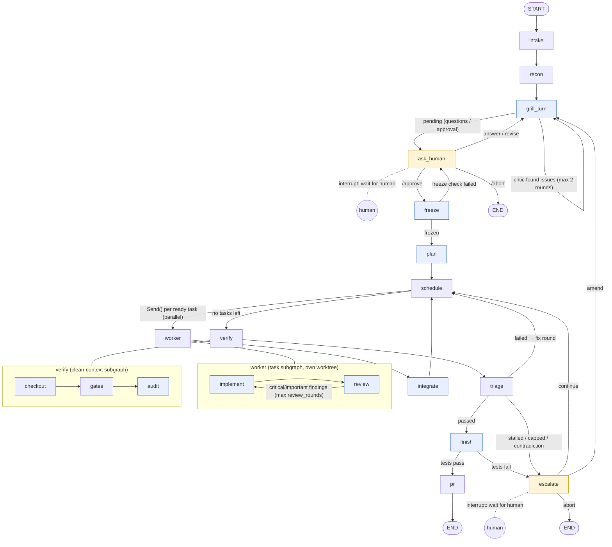
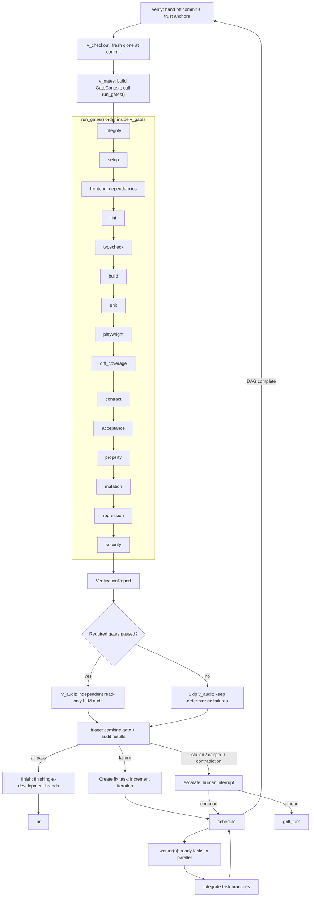

# Graph nodes

How the LangGraph factory turns a request into a PR, node by node, and where the instructions (prompts)
for each agent-backed node live.

- Wiring: [src/factory_app/graph/build.py](../src/factory_app/graph/build.py)
- Node code: [src/factory_app/graph/nodes.py](../src/factory_app/graph/nodes.py)
- State: [src/factory_app/state.py](../src/factory_app/state.py)
- Prompts: [shared/factory_core/prompts/](../../shared/factory_core/prompts/)

## Diagram

Blue nodes call a coding agent (LLM). Yellow nodes pause the graph with `interrupt()` and resume when a
message arrives on `POST /features/{key}/messages`. Everything else is deterministic Python.

## Verification detail

In the main graph, `verify` invokes a separate graph with a fresh checkout. The `gates` box is one
deterministic node; the individual gate names below are the ordered calls made inside `run_gates()`.

The gate sequence is runner order, not a series of LangGraph nodes. `setup` runs only when enabled and
configured for the detected stack. `frontend_dependencies` and `playwright` run only for detected browser
front ends; the latter requires a Playwright config, direct test dependency, E2E script/spec, installs Chromium,
and runs `npm run test:e2e`. Security scanners are optional when their executables are unavailable.
`contract` runs CSV/YAML cases, `acceptance` runs generated Gherkin, and `property` runs property-based cases.
All configured gates run to collect a complete report; the independent audit runs only when required gates pass.

## Nodes

| Node | LLM? | Prompt | What it does |
|---|---|---|---|
| `intake` | no | — | Picks the engine (request or `default_engine`), resets counters, seeds the transcript with the request. Sets `status=grilling`. |
| `recon` | no | — | Clones the repo into `workspaces/<feature>/repo`, creates branch `factory/<feature>`, detects the stack and builds a `repo_map`. Factory commits are rejected outside `factory/*` and `factory-task/*` branches. |
| `grill_turn` | yes (read-only) | `grill.md` | Interviews the requester with Matt Pocock's **`grilling`** skill (grill-me): one turn = one round over the design tree's frontier. The agent returns a `GrillTurn`: either structured **questions** (title, body, lettered options, recommended answer — `yes` accepts the recommendations, `1A, 2B` picks options) or a **draft contract** (`SpecDraft`). Drafts go through a deterministic critic (`pipeline.critique`); if it finds problems the node loops on itself (max 2 rounds) feeding the findings back. Otherwise it renders the contract as markdown and asks for approval. |
| `ask_human` | no | — | `interrupt()`s with the pending questions / approval. On resume: `/abort` → END, `/approve` (on an approval) → `freeze`, anything else is appended to the transcript → `grill_turn`. `/engine <copilot\|claude\|codex>` locks the engine. |
| `freeze` | yes (write) | `driver_writer.md` | Writes the approved contract, including generated `intent.md`, to `.factory/specs/<feature_id>/`, asks the agent to write the **driver** (glue between the tests-as-data and the code) from the stack's template, then runs `pipeline.freeze` (validate, prove tests are not vacuous, hash-lock, commit). Up to 3 attempts; on failure goes back to the human. Contract files are protected from the agent. |
| `plan` | yes (read-only) | `planner.md` | Uses superpowers **`writing-plans`** to split the feature into a `TaskGraph` (tasks with dependencies, each with its `plan` brief: files, interfaces, RED→GREEN steps). Writes the plan document to `.factory/plans/<feature_id>.md` (git-excluded). If the agent fails, falls back to one task covering all ACs. |
| `schedule` | no | — | Clears `task_results`. Its router `route_schedule` fans out one `Send("worker", …)` per ready task, or goes to `verify` when nothing is left. |
| `worker` | — | — | Runs in parallel, one per task, each in its own git worktree/branch. Invokes the **task subgraph** (own `TaskState`) — the graph acts as the superpowers **`subagent-driven-development`** controller. |
| ↳ `implement` | yes (write) | `builder.md` | The SDD implementer seat (`implementer-prompt.md`) with **`test-driven-development`**: builds the task from its brief (plus the previous failure brief on fix rounds, or the review findings on a fix pass), writes its report to `.factory/run/<task>-report.md`, and the factory commits. Protected paths: specs, workflows, CODEOWNERS, stack `guarded_files`, the deployed skills. |
| ↳ `review` | yes (read-only) | `reviewer.md` | **`requesting-code-review`** with the SDD task-reviewer template: a fresh reviewer gets the brief, contract, implementer report and a review package (`.factory/run/<task>-review-N.diff`) and returns a `ReviewResult` (spec compliance + code quality). Critical/important findings → back to `implement`, at most `review_rounds` times (0 disables the review); then the task proceeds and verify/triage take over. |
| `integrate` | only on conflict | `resolver.md` | Merges each task branch into the feature branch. On merge conflicts calls the resolver agent, then cleans up worktrees/branches and marks tasks completed. |
| `verify` | — | — | Invokes the **verify subgraph** with only a commit SHA and trust anchors (`freeze_sha`, `manifest_hash`), never the builder's working dir. |
| ↳ `checkout` | no | — | Fresh `git clone --no-local` at the commit into `verify/iter-N/repo`. |
| ↳ `gates` | no | — | Runs the deterministic gates (`integrity → setup → frontend_dependencies → lint → typecheck → build → unit → playwright → diff_coverage → contract → acceptance → property → mutation → regression → security`) → `VerificationReport`. Front-end-only gates skip for backend projects. |
| ↳ `audit` | yes (read-only) | `auditor.md` | Only if gates passed: an independent agent does the **final whole-branch review** (`requesting-code-review` / `code-reviewer.md`) of the diff, contract and mutation survivors and returns `AuditResult` findings. |
| `triage` | no | — | Passed → `finish`. Failed → builds a `fix-N` task from the failure brief and loops to `schedule`. Escalates if the auditor reports a blocking `spec_contradiction`, the same failure fingerprint repeats `stall_limit` times, or `max_iterations` is reached. |
| `escalate` | no | — | `interrupt()`s with the report. `continue` → new fix round, `amend <change>` → back to `grill_turn` with the change, `abort` → END. |
| `finish` | yes (tests only) | `finisher.md` | superpowers **`finishing-a-development-branch`** with the choice fixed to *push and create a PR*: runs the full test suite and writes the PR title/summary (`FinishResult`). Stray file changes are discarded. Failing tests → `escalate` (`continue` turns the test output into a fix task); otherwise → `pr`. |
| `pr` | no | — | Builds the PR body (finisher summary, contract, report, manifest hash) and opens the PR via `githost` (or writes `PR.md` without `GITHUB_TOKEN`). |

Thresholds used by `triage`, the task review and the gates (`stall_limit`, `max_iterations`, `review_rounds`,
coverage, mutation…) come from `FACTORY_CONFIG` — see [factory.example.yaml](../factory.example.yaml).

## Where the instructions for each node live

Every agent-backed node renders a markdown template from
[shared/factory_core/prompts/](../../shared/factory_core/prompts/) and sends it to the selected CLI
(`copilot`, `claude` or `codex`). The templates tell the agent which **agent skill** to follow and list
"factory overrides" where the skill's interactive behaviour does not apply to a headless run. The skills are
pinned with APM in [factory-skills/](../../factory-skills/README.md) and copied into every agent working
directory before the call:

| Node | Role (`FACTORY_ROLE`) | Template | Skill | Built by |
|---|---|---|---|---|
| `grill_turn` | `grill` | [grill.md](../../shared/factory_core/prompts/grill.md) | `grilling` (grill-me) | `pipeline.grill_prompt` |
| `freeze` | `driver_writer` | [driver_writer.md](../../shared/factory_core/prompts/driver_writer.md) | — | `pipeline.driver_writer_prompt` |
| `plan` | `planner` | [planner.md](../../shared/factory_core/prompts/planner.md) | `writing-plans` | `pipeline.planner_prompt` |
| `worker` ↳ `implement` | `builder` | [builder.md](../../shared/factory_core/prompts/builder.md) | `subagent-driven-development` (implementer), `test-driven-development` | `pipeline.builder_prompt` |
| `worker` ↳ `review` | `reviewer` | [reviewer.md](../../shared/factory_core/prompts/reviewer.md) | `requesting-code-review` (task reviewer) | `pipeline.reviewer_prompt` |
| `integrate` | `resolver` | [resolver.md](../../shared/factory_core/prompts/resolver.md) | — | `render_prompt("resolver", …)` in `Nodes.integrate` |
| `audit` | `auditor` | [auditor.md](../../shared/factory_core/prompts/auditor.md) | `requesting-code-review` (`code-reviewer.md`) | `pipeline.auditor_prompt` |
| `finish` | `finisher` | [finisher.md](../../shared/factory_core/prompts/finisher.md) | `finishing-a-development-branch` | `pipeline.finisher_prompt` |

### How it works

1. The node calls a builder function (table above) which calls `render_prompt(name, **values)`
   ([resources.py](../../shared/factory_core/resources.py)). It loads `prompts/<name>.md` and replaces
   every `{{placeholder}}` with a value. **An unknown placeholder raises `KeyError`**, so prompts never
   ship half-filled.
2. If the node expects structured output (`grill`, `planner`, `reviewer`, `auditor`, `finisher`), the runner
   appends a JSON-Schema suffix generated from the Pydantic model (`GrillTurn`, `TaskGraph`, `ReviewResult`,
   `AuditResult`, `FinishResult`) and validates the answer — don't describe the JSON format by hand in the
   template.
3. The final prompt is written to `<workdir>/.factory/run/<role>-<id>.prompt.md` (with a matching `.log`)
   and passed to the CLI. Read-only roles get read-only tools/sandbox; `protected` paths are denied to
   write roles. Useful for debugging what the agent actually saw.

### Changing instructions

- **Edit the wording / rules of a node:** edit its `.md` template. Applies to both the LangGraph and the
  gh-aw factory, since both use `shared/factory_core`.
- **Change or update a skill:** edit [factory-skills/apm.yml](../../factory-skills/apm.yml) and run
  `apm install` / `apm update` there; commit the lockfile and deployed skill folders.
- **Add a new value to a prompt:** add `{{my_value}}` to the template **and** pass `my_value=...` in the
  builder function / `render_prompt` call listed above (otherwise `KeyError`).
- **Stack-specific driver guidance:** edit the templates in
  [shared/factory_core/stack_profiles/drivers/](../../shared/factory_core/stack_profiles/drivers/) and the
  stack profile YAMLs (e.g. `guarded_files`).
- **Repo-specific conventions:** agents run inside the cloned target repo, so the CLI's native instruction
  files in the *target* repo (`AGENTS.md`, `CLAUDE.md`, `.github/copilot-instructions.md`) are picked up by
  the respective engine in addition to the factory prompt.
- **Model / CLI flags per engine:** `FACTORY_<ENGINE>_ARGS`, e.g. `FACTORY_CLAUDE_ARGS="--model …"`.
- **Adding a new agent node:** create `prompts/<name>.md`, add the node method in `nodes.py` calling
  `self.s.agent(engine).run(AgentRequest(role=..., prompt=render_prompt("<name>", ...), ...))`, register it
  in `build_graph` and wire its edges.
